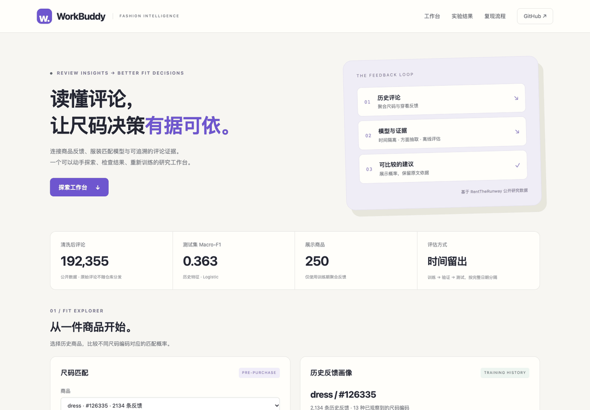

# WorkBuddy · Fashion Review Intelligence

[](https://github.com/yf2685-beep/workbuddy/actions/workflows/ci.yml)


**Turn clothing reviews into traceable product insights and comparable fit predictions.**

WorkBuddy 是一个面向服饰电商的评论洞察与尺码匹配研究项目。它把公开数据清洗、历史反馈聚合、模型训练、离线评估和交互看板连接成可复现流程，帮助探索「哪里不合身、依据是什么、不同尺码如何比较」。



*真实本地界面录制：修改身高体重 → 比较尺码 → 切换商品 → 抽取评论证据 → 查看模型结果。演示输入为合成示例；指标和商品聚合来自实际训练。*

## What you can explore

| 功能 | 实际实现 |
| --- | --- |
| 商品反馈画像 | 250 个商品的训练期偏小 / 合身 / 偏大分布，以及负面方面占比 |
| 尺码候选比较 | 根据身高、体重、可选体型，比较商品已有尺码编码的三类概率 |
| 评论洞察 | 从英文评论抽取尺码、版型、面料、长度及情感，保留原文证据 |
| 实验看板 | 多数类、元数据逻辑回归、历史增强逻辑回归、MLP 的实测结果 |
| 可复现流程 | CLI 完成下载、清洗、按时间拆分、训练、评估及 JSON 模型导出 |

默认评论抽取使用可检查的关键词规则，无需外部服务。可选 LLM 适配器支持 OpenAI-compatible Chat Completions，并校验输出结构和证据是否来自原文。

## Run locally

需要 Python 3.11。仓库已包含训练后的 JSON 模型和指标，启动演示无需原始数据或 API Key。

```bash
git clone https://github.com/yf2685-beep/workbuddy.git
cd workbuddy
python3.11 -m venv .venv
source .venv/bin/activate
python -m pip install -c requirements-lock.txt .
workbuddy serve
```

打开 **http://127.0.0.1:8080**。Windows 使用 `.venv\Scripts\activate` 激活环境。请在仓库根目录运行，或通过 `workbuddy serve --root /path/to/workbuddy` 指定报告位置。这是本地研究演示，尚未部署线上服务。

## Measured results

RentTheRunway 原始 **192,544** 条交易，移除 **189** 条完全重复记录后保留 **192,355** 条。按完整日期约 70% / 15% / 15% 划分。以下为一次固定种子实验，完整结果见 [metrics.json](reports/metrics.json)。

| Model | Validation Macro-F1 | Test Macro-F1 | Test accuracy |
| --- | ---: | ---: | ---: |
| Majority class | 0.2802 | 0.2811 | 72.91% |
| Metadata + Logistic Regression | 0.2922 | 0.2983 | 30.45% |
| **Historical features + Logistic Regression** | **0.4154** | **0.3634** | **37.84%** |
| Historical features + MLP (64, 32) | 0.4090 | 0.3586 | 36.84% |

模型根据**验证集 Macro-F1** 选择，本轮历史增强逻辑回归胜出。相对元数据逻辑回归，测试 Macro-F1 增加 **0.0651**。历史特征同时包含 fit 标签分布与规则提取的负面方面；这个对比**不能单独归因于评论语义，也不是 LLM 带来的提升**。

测试集中 72.91% 为合身，多数类预测因此准确率高，但完全无法识别偏大、偏小。平衡类别权重的模型提高了 Macro-F1，同时降低整体准确率。验证与测试结果仍有差距；当前模型适合展示研究方法，不足以证明实际退货率或转化率改善。

| Split | Rows | Dates |
| --- | ---: | --- |
| Train | 134,472 | 2010-11-03 → 2017-03-26 |
| Validation | 28,953 | 2017-03-27 → 2017-08-29 |
| Test | 28,930 | 2017-08-30 → 2018-01-08 |

## Engineering decisions

- **时间隔离：** 训练样本只读取更早日期的历史反馈；同日记录统一生成特征后才更新历史。验证和测试固定使用训练结束时的历史。
- **购买前可用特征：** 目标评论、目标标签、评分和用户 ID 不作为预测输入。用户在看板提交的新评论只用于独立的洞察展示。
- **可追溯的抽取：** 返回方面、情感和原文证据；LLM 响应结构异常或引用不匹配时明确报错。原文匹配不代表语义判断一定正确。
- **轻量推理：** 导出 JSON 权重、标准化参数和聚合商品画像，使用 NumPy 推理；训练时对照 sklearn 检查预测一致性。
- **端到端实现：** Python / scikit-learn 数据管线，Flask API，响应式 HTML/CSS/JavaScript 看板，pytest 与 GitHub Actions。

这是一套确定性工作流，加上可选 LLM 抽取节点；目前没有自主规划、多 Agent 协作或工具调用循环。详见 [架构与 API](docs/architecture.md) 和 [数据及模型说明](docs/model-card.md)。

## Reproduce the experiment

```bash
# 自动下载官方数据并训练；不调用 LLM
OPENBLAS_NUM_THREADS=1 OMP_NUM_THREADS=1 workbuddy run

# 或对已下载数据重新训练
workbuddy train --data data/raw/renttherunway.json.gz --output reports
```

命令覆盖输出目录中的 `metrics.json` 和 `demo-model.json`；保留已发布结果时使用 `--output reports/local-run`。训练完成后重启网页进程加载新结果。`--limit` 可运行小样本实验，但结果不应与完整数据结果混用。

依赖版本记录于 [requirements-lock.txt](requirements-lock.txt)。不同平台或数值库可能产生细微差异。训练方法、缺失值、类不平衡、MLP 提前停止方式及局限见 [model card](docs/model-card.md)。

### Optional LLM extraction

在启动应用的同一终端设置 `WORKBUDDY_LLM_MODEL`、`WORKBUDDY_LLM_API_KEY`，以及可选的 `WORKBUDDY_LLM_URL`，再运行 `workbuddy serve`。变量名见 [.env.example](.env.example)；应用不会自动加载 `.env`。

网页只有在配置齐全后才启用 LLM 选项。选择 LLM 后，提交的评论会发送到配置的服务；规则模式完全本地运行。当前没有调用付费 API，也没有声称 LLM 已通过人工基准评估。

### Tests and demo assets

```bash
python -m pip install -c requirements-lock.txt '.[dev]'
python -m pytest -q

# 保持本地网页运行，在另一个终端录制
python -m playwright install chromium
python scripts/capture_demo.py
```

测试覆盖日期隔离、标签泄漏、输入边界、证据校验与网页 API。录制脚本同时检查桌面和手机上的推荐及评论流程，再生成 README 截图和动图；也可通过 `--browser /path/to/chrome` 使用本机 Chrome。

## Scope and next steps

- **当前已完成：** RentTheRunway 数据管线、规则洞察、LLM 适配器、两类模型对照、离线指标、可运行看板和动画。
- **待完成：** 人工标注 200 条评论并衡量抽取质量；ModCloth 外部验证；规则 / LLM 方面特征消融；概率校准和多随机种子实验。标注导出和规则评估命令见 [model card](docs/model-card.md)。
- **尺码含义：** 展示数据集原始编码，不是品牌通用 S / M / L。只比较训练期至少出现 3 次的候选；概率未经校准。
- **评估边界：** 报告衡量已购买尺码的 fit 分类；没有同一用户购买所有候选尺码的反事实标签，因此尚未直接验证尺码排序质量。

## Data and attribution

数据来自 [UCSD McAuley Lab Clothing Fit](https://cseweb.ucsd.edu/~jmcauley/datasets.html#clothing_fit)。

Rishabh Misra, Mengting Wan, Julian McAuley. **Decomposing fit semantics for product size recommendation in metric spaces.** RecSys 2018. [Paper](https://cseweb.ucsd.edu/~jmcauley/pdfs/recsys18e.pdf). 本项目使用其公开数据，不声称复现论文模型。

仓库不分发原始评论或用户记录，只提供下载器、汇总指标、模型系数和商品聚合。原始代码采用 [MIT License](LICENSE)；数据及其衍生产物的使用仍须遵循数据来源的适用条款，代码许可证不授予数据权利。
