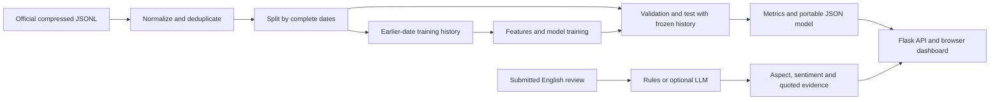

# Architecture and API

WorkBuddy implements a local, reproducible fashion review workflow. The default path uses rules and sklearn; the optional LLM is a separate extraction adapter.



The submitted review does not enter the fit predictor. Training history includes only earlier feedback; unseen items use smoothed default history in evaluation. The demonstration catalog is restricted to the 250 most-reviewed training items with at least 20 observations.

## Source map

| File | Responsibility |
| --- | --- |
| `src/workbuddy/data.py` | Official download, units, missing values, exact deduplication, chronological split |
| `src/workbuddy/aspects.py` | English rule baseline, optional LLM call, evidence/schema validation |
| `src/workbuddy/model.py` | Historical feature construction, JSON serialization/inference, candidate ranking |
| `src/workbuddy/train.py` | Four model comparisons, validation selection, metrics/model export |
| `src/workbuddy/cli.py` | Download/train/serve commands and manual annotation workflow |
| `src/workbuddy/web.py` | Local Flask application with validated JSON endpoints |
| `src/workbuddy/templates/`, `static/` | Responsive dashboard with no frontend build step |
| `reports/` | Published experiment and model/aggregate catalog; no raw reviews |
| `tests/` | Pipeline, leakage, evidence and API regression checks |
| `scripts/capture_demo.py` | Real-browser desktop/mobile checks and screenshot/GIF capture |

## API

Run from the cloned repository so the application can find `reports/`. No authentication or persistence layer is provided; the default server binds to `127.0.0.1`.

| Method | Path | Returns |
| --- | --- | --- |
| GET | `/health` | Server and model readiness |
| GET | `/api/overview` | Report, catalog count, whether LLM configuration is present |
| GET | `/api/catalog` | Training-period item aggregates and size-code counts |
| POST | `/api/recommend` | Observed size candidates with small/fit/large probabilities |
| POST | `/api/extract` | Aspect, sentiment and exact evidence quotes |

Example extraction:

```bash
curl http://127.0.0.1:8080/api/extract \
  -H 'Content-Type: application/json' \
  -d '{"review":"The fabric is soft. The hem is too long.","engine":"rules"}'
```

Example recommendation (use an item from `/api/catalog`):

```json
{
  "item_id": "126335",
  "height_cm": 175,
  "weight_kg": 70,
  "body_type": "athletic"
}
```

Profile validation accepts finite height 120–220 cm and weight 30–250 kg, an enumerated optional body type, and a supported item. Reviews must contain 1–8,000 characters; total request bodies are limited to 32 KiB. Inputs are not persisted. These input bounds are application validation rules, not claims of representative data coverage across these ranges.

LLM credentials remain on the server. The adapter requires HTTPS, imposes a timeout, treats the review as data, validates aspects/sentiments and checks exact evidence substrings. It does not silently fall back to rules. Literal evidence validation cannot prove correct sentiment, completeness, or resistance to every prompt injection.

## Extending the project

Keep extraction benchmarks separate from fit prediction. Add a new feature family with an explicit information timestamp and compare it on the same chronological split. Preserve frozen training history for final evaluation. Do not optimize model settings repeatedly against the published test set; use validation or a fresh evaluation window.

Before using this outside the local demonstration, the project still needs a production server, access control appropriate to its deployment, monitoring and a validated policy for user-supplied data.
